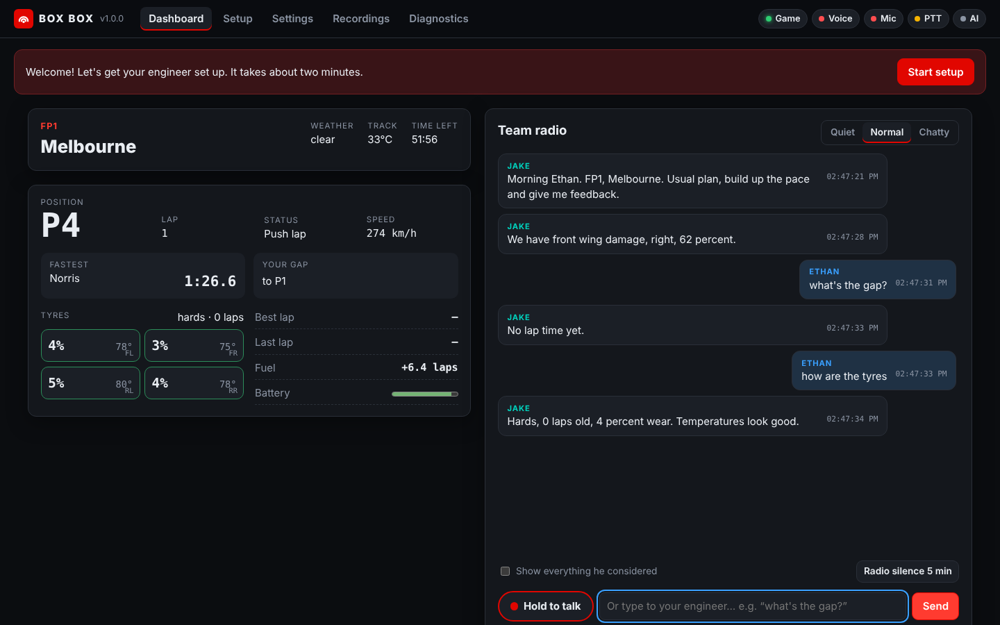
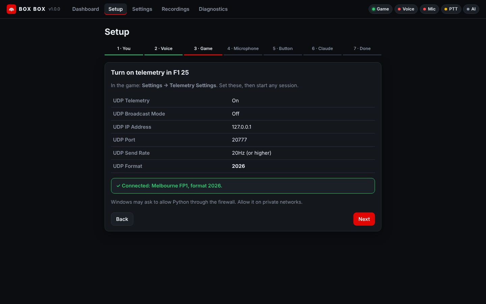

# Box Box 📻

**An AI race engineer for F1 25 (2026 Season Pack).** He watches the live telemetry of every car, talks to
you over a team-radio voice at the right moments, and answers when you hold the button on your wheel.



- **Talks like a real engineer.** Short, numbers first, on the straights, never in the braking zones.
  Urgent calls cut in, chatter is rationed, and he goes quiet on your qualifying push lap.
- **Knows the whole field.** Traffic on out laps, cars leaving the pits, yellow flags ahead, safety car and
  VSC, gaps and trends, undercut threats, pit window, overtakes, tyres, damage, punctures, fuel, weather,
  2026 overtake mode and battery, lap and sector feedback, the quali drop zone, the finish.
- **You can talk back.** Hold a wheel button and ask anything: *"what's the gap?"*, *"how are the tyres?"*,
  *"where's Leclerc?"*, *"less radio please"*, *"should we try a two-stop?"*
- **Runs on your PC.** A natural neural voice and speech recognition run locally (GPU if you have one).
  An AI model is optional and adds open conversation, strategy chat and post-session debriefs: Claude,
  OpenAI, Gemini, OpenRouter, Poe, or a free local model with Ollama or LM Studio.
- **Thinks like an engineer.** Plan A or plan B on tyre deg, "plan A plus three" when the tyres hold,
  boxing under a safety car when you're in the window, rivals yet to stop, tyre offsets in gap calls, a
  grid tyre brief before the start. He asks how the balance is and remembers what you tell him.
- **Remembers you.** Every session is recorded and logged; he learns your notes and results over time.

---

## Quick start (Windows)

1. **Get it.** If you haven't already: `git clone https://github.com/ethandadev/box-box` in your user folder
   (not `C:\Windows\system32`). Or update an existing copy with **`Update Box Box.bat`**.
2. **Double-click `Box Box.bat`.** The first start installs everything it needs (Python, the voice, speech
   recognition), so give it a few minutes. Later starts take seconds.
   - Optional: double-click **`Create desktop shortcut.bat`** for a Box Box icon on your desktop.
3. **Follow the setup in your browser** (it opens automatically, about 2 minutes):
   name and personality → voice → game settings → microphone → push-to-talk button → AI (optional).
4. **In F1 25: Settings → Telemetry Settings:**

   | Setting | Value |
   |---|---|
   | UDP Telemetry | On |
   | UDP Broadcast Mode | Off |
   | UDP IP Address | 127.0.0.1 |
   | UDP Port | 20777 |
   | UDP Send Rate | 20Hz (or higher) |
   | UDP Format | **2026** |

5. **Drive.** Keep the Box Box window open (minimised is fine). He'll do a radio check as you leave the
   garage.



## Talking to your engineer

Hold your push-to-talk button (or click **Hold to talk** on the dashboard, or type in the box) and speak
normally. Release when you're done. He'll cut himself off when you press the button, like a real radio.

**Instant answers (work offline, no API key):**

| Say | He answers with |
|---|---|
| "Radio check" | "Loud and clear, Ethan." |
| "What's the gap?" / "Gap behind?" | Gaps to the cars around you (in practice: your best vs the fastest) |
| "Where's Norris?" | Their position and gap to you |
| "How are the tyres?" | Compound, age, wear, worst corner, temperatures, laps left in them |
| "Fuel?" / "Damage?" / "Weather?" / "Battery?" | Straight from telemetry |
| "How many laps left?" / "What was that lap?" | Laps or time remaining / last and best lap |
| "Box box" / "Stay out" | Confirms (you still box on the MFD) |
| "What's the plan?" | Plan A or B, when we box, how long the tyres have |
| "Say again?" | Repeats his last call |

**Radio commands:**

| Say | Effect |
|---|---|
| "Less radio" / "Only the essentials" | Quiet mode |
| "Keep me updated" / "More radio" | Chatty mode |
| "Radio silence for 5 minutes" | Safety calls only for a while |
| "You can talk again" | Back on |
| "Gaps every lap" | Changes the gap frequency |
| "No more tyre info" | Turns off tyre calls |
| "Remember that I struggle in turn 9" | He'll remember it for future sessions |

**With an AI model** (Setup → AI): anything else, like *"how are we doing against Leclerc on tyres?"* or
*"would a two-stop work?"*. He looks the data up live, so every number he says is real, knows what he
told you a minute ago, and gives a short spoken debrief after each session. Pick any of:

| Service | What you need | Good model for radio |
|---|---|---|
| Anthropic Claude | API key from console.anthropic.com | `claude-haiku-5-5` (default) |
| OpenAI | API key from platform.openai.com | `gpt-5-mini` |
| Google Gemini | API key from aistudio.google.com (free tier) | `gemini-2.5-flash` |
| OpenRouter | One key for hundreds of models | `google/gemini-2.5-flash`, any model id |
| Poe | Poe API key (uses your points) | `Gemini-2.5-Flash`, any bot name |
| Ollama / LM Studio | Runs on your PC, free and private | Any model that supports tools, e.g. `qwen3:14b` |
| Other | Any OpenAI-compatible server (vLLM, Groq, DeepSeek…) | Its server address and model id |

Type any model id, or click **List models** to see what your key or server offers. **Test connection**
checks it end to end. Cloud models cost cents per race.

## What he tells you

| Session | Calls |
|---|---|
| **Practice** | Radio check as you leave the garage · "how's the balance?" (he remembers the answer) · front wing damage means "bring it in" · cars on push laps behind you on your out/in lap ("let them by") · slow cars ahead on your push lap · cars leaving the pits ahead · lap times, personal bests, where you lost time · purple sectors (chatty) · long-run summary when you pit · time remaining |
| **Qualifying** | As practice, plus: each new run with the clock and out-lap job · the drop-zone warning and "you're safe" · "last chance" on your final lap · lap deleted for track limits · **only traffic and safety calls on your push lap** |
| **Race** | Grid tyre brief and lap-one summary · plan A / plan B / "plan A plus three" from your tyre deg · "happy to push on these tyres" · the safety-car window, and box under the safety car · rivals yet to stop and tyre offsets · gaps and whether you're closing · within a second of the car ahead · overtakes made and lost · cars around you pitting (undercut threat) · pit window and "box box" · your stop time and position · tyre wear, overheating, punctures, damage · fuel saving · rain on the radar, rain starting, wrong tyres · 2026 overtake mode and low battery · safety car / VSC / red flag / green · penalties and track-limit warnings · laps to go · last lap · the result |

**Voices.** Kokoro runs on your PC for free, with a pronunciation dictionary for the grid and the
corners (luh-CLAIR, oh-CON, Eau Rouge) and clipped, radio-paced delivery. For a properly human voice pick
**Google Gemini** (free tier: paste a key from aistudio.google.com/apikey into Settings → Voice), **OpenAI**
or **ElevenLabs**. Each has its own key field in the Voice section, so it works whichever AI you chat with.
If a cloud voice refuses (bad key, out of credits) the app switches to Kokoro for the rest of the session
and Diagnostics says why.

**The radio.** Every transmission keys up like the real thing: a click and the beep, a moment of open
channel, the voice swelling in narrow-band over a hiss floor, then the hiss tail and the closing beep.
Sometimes he holds the key between two sentences while he checks something. Your own push-to-talk
clicks and chirps too. **Radio effect** goes from studio-clean (0) to a crackly onboard radio (1). **Radio overdrive** pushes the voice into the radio's clipping and turns it back down, so it's grittier at the same volume (12 dB default; 0 clean, 20+ a bad signal). **Speaking speed** (up to 1.6, default 1.25) applies to every voice: where a cloud voice can't go that fast itself, it's sped up without changing pitch.

He sounds like a person, not a script: now and then a "mate", an "Okay, so...", "copy, copy", or a quick
self-correction on a gap like *"1.3, sorry, 1.2"* (the correction is always the real number). Never on
urgent calls or lap times. **Settings → Engineer → Natural speech** sets it to Off, Subtle (default) or
Very human.

**Diff, brake bias, ERS and fuel map.** Ask "I keep getting wheelspin, any diff advice?", "brake bias?",
"what ERS mode?" or "fuel map?" and he answers with the change to make on the MFD: *"Lower the diff, try 65,
should help with the rears out of turn 14"*, *"Bias back two, 54"*, *"Energy mode medium"*, *"Fuel map lean,
and lift and coast"*. He also watches the wheels (the game's wheel-slip data): wheelspin or lock-ups at the
same corner lap after lap get a suggestion unprompted, and so does a flat battery in hotlap mode.

**Sprint weekends.** The sprint is called the Sprint (the game says "Race"), with no pit-stop talk and
points for the top 8; sprint qualifying is SQ1 to SQ3.

Everything is tunable in **Settings**: personality (calm / fired up / dry), how much he talks, which
categories, gap frequency, only-on-straights, voice, speed, radio effect, devices and more. Changes apply
instantly.

## Troubleshooting

The **Diagnostics** page checks everything and has **Fix** buttons. **Copy support report** gives you
something to paste when asking for help.

| Problem | Fix |
|---|---|
| Dashboard says "Waiting for the game" | Check the telemetry settings above, then start a session (not just the menus). |
| "UDP port 20777 is in use" | Another telemetry app (SimHub, Crew Chief…) is using it. Close it, or change the port in both Box Box Settings and F1 25. |
| He's silent | Check the Voice pill. Pick your headset in Settings → Voice and click **Play a radio check** in Setup. |
| He doesn't hear me | Pick your mic in Setup → Microphone and watch the level meter. Windows Settings → Privacy → Microphone must allow desktop apps. |
| Wheel button not detected | Make sure the wheel base is on (it can be plugged in any time), then Setup → **Learn button**. Or bind a wheel button to *UDP Action 1* in F1 25's controls and use that. |
| Speech recognition is slow | Diagnostics → **Fix** on Speech recognition installs NVIDIA GPU support (about 1 GB, one time). |
| The voice sounds robotic | That's the Windows backup voice while the natural voice downloads (about 350 MB). It switches automatically when ready. |
| The voice changed mid-session | The cloud voice refused (out of credits, bad key) or the network dropped, and the local voice took over. Diagnostics says which; top up, fix the key, or pick another voice. |
| He talks too slowly | Raise **Speaking speed** in Settings → Voice (up to 1.6). It applies to every voice. |
| Game on another PC or a console | Settings → Telemetry → "Accept telemetry from other devices", and send to this PC's IP address. |

Logs live in `%LOCALAPPDATA%\BoxBox\logs` (Diagnostics → **Open logs folder**).

## Privacy & costs

Everything runs on your PC: the voice, speech recognition, recordings and memory (in
`%LOCALAPPDATA%\BoxBox`). Only if you set up a cloud AI service are your questions and a short summary of
the session sent to that service to generate replies (with Ollama or LM Studio nothing leaves your PC). Keys are stored only on this PC. The web UI only listens
on `127.0.0.1`.

---

## For developers

```powershell
uv sync
uv run box-box                 # the app (engine + UI)
uv run box-box doctor          # check the setup
uv run box-box watch -f recordings\x.f1raw.gz -s 0   # print every call the detectors make, flat out
uv run box-box replay recordings\x.f1raw.gz         # resend a recording over UDP
uv run pytest ; uv run ruff check . ; uv run ruff format .
```

```
F1 25 ──UDP──► telemetry/ (decode all 24 cars, both formats) ──► state/World (laps, pits, gaps, changes)
                   │ auto-record                                     │
                   ▼                                                 ▼
              recordings/                         engineer/ detectors ──► RadioDirector (priority, straights,
                                                                          budget, staleness, barge-in)
wheel/keys/UDP action ─► voice/ptt ─► mic ─► stt (whisper)                     │
                                         └─► brain/ (instant intents → any AI + tools)  ──► replies
                                                                               ▼
                                              voice/ speaker: Kokoro TTS → radio FX → audio out
                         ui/ (aiohttp + WebSocket) ◄── bus ◄── everything
```

| Package | What's there |
|---|---|
| `telemetry/` | UDP decoder for formats 2025 and 2026, recordings (`.f1raw[.gz]`), UDP/file sources, auto-recorder |
| `state/` | `World`: the live session, per-car lap history, change events, on-road geometry |
| `engineer/` | Detectors (traffic, flags, race, strategy, laps, car, weather, session, energy), phrasebook, radio director |
| `voice/` | TTS engines + work queue, radio effect, audio output, mic, push-to-talk, speech recognition, model downloads |
| `brain/` | Live-data tools, instant intents, AI providers and backends (Anthropic + OpenAI-compatible), conversation, debriefs |
| `memory/` | SQLite: sessions, laps, notes, radio log |
| `ui/` | Local web UI: setup wizard, dashboard, settings, recordings, diagnostics |
| `app.py` | The engine that wires it all together |

Tests replay real game recordings (including Ethan's practice session over real UDP) and simulate
scenarios packet by packet. CI runs on Windows and Linux.

### Credits

UDP layouts follow EA's *F1 25: 2026 Season Pack UDP Specification*, cross-checked against
[MacManley/f1-26-udp](https://github.com/MacManley/f1-26-udp) and
[rdgonzaga/f1-game-telemetry](https://github.com/rdgonzaga/f1-game-telemetry) (both MIT). The test fixtures
in `tests/fixtures/` come from the latter (see `tests/fixtures/NOTICE.md`). Voice:
[Kokoro](https://github.com/thewh1teagle/kokoro-onnx). Speech recognition:
[faster-whisper](https://github.com/SYSTRAN/faster-whisper).
